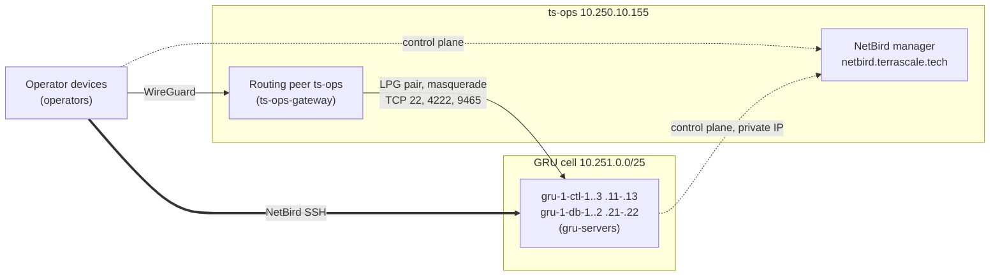

# NetBird

Current state: the GRU testing reset removed its server peers, setup keys,
group, access policies, routing network and `gru.ts.internal` zone. The manager,
ts-ops peer, operator devices and Forgejo access policies are preserved.
The GRU cell is wiped entirely and rebuilt as `gru-1` while ts-ops (Forgejo
and the manager) stays: follow [Fresh cell enrollment](#fresh-cell-enrollment).
See
[current regional reset](../../docs/region-bootstrap.md#current-gru-reset).

Self-hosted NetBird at `https://netbird.terrascale.tech` gives enrolled
operator devices private access to ts-ops. The intended GRU topology below
adds access to the cell (private subnet
`10.251.0.0/25`) and to Forgejo on ts-ops. The manager (combined server and
dashboard) and the routing peer run on ts-ops, next to Forgejo. Every GRU
controller and managed host is also a NetBird peer, reached with NetBird SSH.



Only `10.250.10.155/32` is routed into the cell, and the cell NSGs admit it
on TCP 22, 4222 and 9465 only. Peers reach the manager over HTTPS/gRPC on 443
and STUN on UDP 3478 (Caddy on ts-ops, then `netbird-server` on
`127.0.0.1:18081`). Private servers reach it on its private IP with the public
TLS name; they need no internet route.

## Ownership

ts-orchestrator is the single home of TerraScale's NetBird. `ts-infra`
OpenTofu manages infrastructure only, and HomeLab no longer owns NetBird.

| Part | Where |
| --- | --- |
| Groups, policies, network, DNS zone and records, DNS and account settings | Desired state embedded in the `ts-orch` binary; [reconciliation](#desired-state-and-reconciliation) |
| Manager host bundle: Quadlets, systemd units, installers, backup, firewall, Caddy block | [`manager/`](manager), staged at `/opt/ts-ops/netbird` |
| Server client install and automatic enrollment | [Server enrollment](#server-enrollment), `deploy/systemd`, image inputs |
| OCI side: LPG pair, routes, cell NSG rules | [Operator gateway peering](../../docs/region-bootstrap.md#operator-gateway-peering) |
| ts-ops host (Forgejo, Caddy, ports, backups) | ts-ops host runbook |

Do not edit groups, policies, networks or settings in the dashboard. A
dashboard edit is drift: the next reconciliation reverts it.

## Desired state and reconciliation

The desired state is compiled into `ts-orch`; change it in Go, with review,
and release it like any other change.

| Command | Effect |
| --- | --- |
| `ts-orch netbird sync [--apply] [--pat-file FILE]` | Compares the manager with the desired state and prints the plan; `--apply` reconciles it |
| `ts-orch netbird prune-peers [--apply] [--offline-for DURATION]` | Plans peer hygiene for `gru-servers`: deletes disconnected peers that hold a live slot's IP or name, deletes unmatched peers offline longer than the threshold (default `24h`, minimum `1h`), and renames each slot's live peer to its slot name; `--apply` performs it |
| `ts-orch netbird remove-peers (--slot NAME... \| --all) [--apply]` | Plans deleting the disconnected `gru-servers` peers of decommissioned slots (matched by slot IP or slot peer name, e.g. `--slot ctl-1`), or every disconnected server peer with `--all`; connected peers are reported and kept |
| `ts-orch netbird setup-key --out FILE [--apply]` | Plans the server setup key `gru-servers`: reusable, never expiring, auto-assigning only `gru-servers`; `--apply` creates it and writes its value only to FILE, a new `0600` file |
| `ts-orch netbird inventory` | Prints groups, policies, networks, DNS and peers as the manager reports them |

Without `--apply` the commands only read. Keep the PAT in a root-owned `0600`
file, never on the command line: `--pat-file` (a regular `0600` file, symlinks
refused) or the `NB_PAT` environment variable. `--management-url` overrides
`https://netbird.terrascale.tech` (plain HTTP only on loopback, for tests).
`inventory` prints allowlisted JSON and never setup-key values. Objects are
matched by name; a `renamed_from` list renames legacy objects in place, keeping
their IDs, members and setup-key auto-groups. Groups, policies, networks and
zones are never deleted; the `gru.ts.internal` zone is fully owned, so stray
records in it are removed. The server setup key is only checked, never
changed; `sync` warns when it auto-assigns any group besides `gru-servers`.
`sync` also warns about every policy outside the desired state, such as the
default `All` policy; delete those in the dashboard. `sync` refuses before any
change when the subnet differs, an
unexpected router exists, or a name is ambiguous. On a fresh account, before
the `ts-ops` peer is in `ts-ops-gateway`, it creates the groups and other
policies and defers the network, its resource and router and the policy
targeting the resource with a warning; the next sync after the routing peer
joins creates them. An existing network without its router peer is refused.

The cell's leader controller reconciles automatically when an admin PAT
secret is configured and its `netbird.json` belongs to cell `gru-1`: region
`sa-saopaulo-1` and `peer_names` equal to the desired state. Any other cell's
controller logs `NetBird manager reconciliation disabled: …` instead of
reconciling, or pruning, `gru-1`. It runs `sync --apply` and prunes replaced servers' peers
on a loop. Every controller runs the loop but only the authority lease holder
(`CanMutate`) acts: first pass about 30 s after start, then every 5 min ±20%,
backing off from 30 s to 30 min after failures. NetBird errors are logged and
never block the controller. The PAT's OCI Vault secret OCID is the optional
`admin_pat_secret_id` field of `netbird.json`; the controller reads the current
secret version every cycle, so rotating the secret needs no restart. When the
field is absent the controller logs `NetBird manager reconciliation disabled`
once and operators run the commands by hand. Only controllers may read the
secret, through a separate policy (the oci-region live check expects the
existing NetBird policy's statements verbatim):

```text
Allow dynamic-group terrascale-orchestrator to read secret-bundles in compartment id <secret_compartment_id> where target.secret.id = '<admin PAT secret OCID>'
```

If the secret lives in the control compartment, the existing broad
`read secret-bundles` grant already covers it. Enable it:

1. Store the `ts-orchestrator` service user's PAT (below) as an OCI Vault
   secret and add the policy.
2. Run `ts-orch netbird sync`, review, then `sync --apply`; a second `sync`
   must print no changes. Do the same with `prune-peers`.
3. Set `admin_pat_secret_id` in `deploy/image/inputs/netbird-gru.json`, update
   its SHA-256 pin in `deploy/image/image-inputs.json`, and roll the image.
4. Controller logs show `NetBird manager reconciliation enabled on the cell
   authority holder`, then `NetBird <step> applied: …` for each change,
   `NetBird <step> warning: …`, or `NetBird management failed, retrying in …`.

Peers join groups only through setup keys and user auto-groups;
reconciliation never sets group membership.

### Names

| Group | Members | Joined by |
| --- | --- | --- |
| `operators` | Operator devices | User auto-group, or a one-off setup key |
| `ts-ops-gateway` | ts-ops only | One-off gateway setup key |
| `gru-servers` | GRU controllers and managed hosts | Reusable server setup key |

Network `gru-cell` ("TerraScale GRU private cell") holds resource
`gru-cell-private-subnet` (`10.251.0.0/25`) and one router: peer `ts-ops`,
masquerade on, metric 100. The router must be in `ts-ops-gateway`.

| Policy (= rule name) | Source → destination | Protocol, ports | Direction |
| --- | --- | --- | --- |
| `operators-to-gru-cell-ops-ports` | `operators` → resource `gru-cell-private-subnet` | TCP 22, 4222, 9465 | one-way |
| `operators-to-gru-servers-ssh` | `operators` → `gru-servers` | `netbird-ssh` | one-way |
| `operators-to-ts-ops-forgejo` | `operators` → `ts-ops-gateway` | TCP 22, 443, 2022 | one-way |
| `operators-to-ts-ops-ping` | `operators` → `ts-ops-gateway` | ICMP | one-way |

There is no default `All` policy. Do not allow 6222 or 8443 to operators. The
`netbird-ssh` policy makes the manager enable each server's NetBird SSH
server; every session still requires the operator's IdP login.

### Control Center diagram conventions

The dashboard's Control Center draws every policy; keep it readable:

- One rule per policy, rule name equal to the policy name. The 0.79 manager
  stored only a policy's first rule.
- Never use `All` as a source or destination.
- Three ports or fewer per rule.
- No bidirectional rules unless the destination must open connections back.
- Short peer names (`ts-ops`, `gru-1-ctl-1`); they become DNS labels.
- Delete disabled or stale policies, and prune stale peers.

## DNS

| Domain | Holds | Served to |
| --- | --- | --- |
| `nb.ts.internal` | Peer names (account DNS domain), e.g. `ts-ops`, `gru-1-ctl-1`, `mariogk-laptop` | Every peer with NetBird DNS on |
| `gru.ts.internal` | Stable cell names (custom zone, no search domain) | `operators` only |

`gru-servers` keep NetBird DNS management disabled, matching their
`--disable-dns` enrollment. `.local` is avoided: it is reserved for mDNS and
systemd-resolved sends it to multicast. Cell names point at fixed slot private
IPs and never change across GRU revisions or deployments.

| Name | Address and port | What it is |
| --- | --- | --- |
| `ctl-1.gru.ts.internal` | `10.251.0.11:22` | OpenSSH, controller 1 |
| `ctl-2.gru.ts.internal` | `10.251.0.12:22` | OpenSSH, controller 2 |
| `ctl-3.gru.ts.internal` | `10.251.0.13:22` | OpenSSH, controller 3 |
| `db-1.gru.ts.internal` | `10.251.0.21:22` | OpenSSH, TerraBase member 1 |
| `db-2.gru.ts.internal` | `10.251.0.22:22` | OpenSSH, TerraBase member 2 |
| `nats.gru.ts.internal` | `10.251.0.11-13:4222` | NATS TLS on the controllers |
| `terrabase.gru.ts.internal` | `10.251.0.21-22:9465` | TerraBase HTTPS API on the members |
| `gru-1-ctl-1.nb.ts.internal` etc. | peer NetBird IP | NetBird SSH to a GRU server |
| `ts-ops.nb.ts.internal` | `10.200.106.253:2022` | ts-ops host admin SSH |

```sh
netbird ssh root@gru-1-ctl-1.nb.ts.internal
ssh -i ~/.ssh/terrascale-owner ubuntu@ctl-1.gru.ts.internal
ssh -p 2022 mariogk@ts-ops.nb.ts.internal
```

TLS on 4222 and 9465 verifies against the private IP, so clients that verify
the certificate keep using the IP; the names are for humans and SSH. TerraBase
admin endpoints (`/healthz`, `/readyz`, `/metrics`) listen on `127.0.0.1:9464`
of each member and are reached only through a NetBird SSH tunnel:

```sh
netbird ssh -L 9464:127.0.0.1:9464 root@gru-1-db-1.nb.ts.internal
curl -fsS http://127.0.0.1:9464/readyz
```

Forgejo (`git.terrascale.tech`) and the dashboard keep their public names,
because Caddy routes by Host; over NetBird, pin the name to ts-ops' NetBird IP
(`curl --resolve git.terrascale.tech:443:10.200.106.253 ...`).

### Stable peer names

Servers enroll under their [static names](../../docs/region-bootstrap.md#static-names)
`<region>-<index>-<role>-<n>`: controllers `gru-1-ctl-1`..`3` and TerraBase
members `gru-1-db-1`..`2`, taken from the `peer_names` map in `netbird.json`
(private IP → name), read from the primary VNIC's private IPv4 in OCI
instance metadata:

```json
"peer_names": {
  "10.251.0.11": "gru-1-ctl-1",
  "10.251.0.12": "gru-1-ctl-2",
  "10.251.0.13": "gru-1-ctl-3",
  "10.251.0.21": "gru-1-db-1",
  "10.251.0.22": "gru-1-db-2"
}
```

The names are `<cell>-<slot>` (cell `gru-1`, slots `ctl-1`, `db-1`, …) from
`manager.GRU()` in
[`internal/netbird/manager/desired.go`](../../internal/netbird/manager/desired.go),
the single source. Its validation, like every `netbird.json` reader including
the image builder, rejects a name outside `internal/naming`; the image input
repeats them for enrollment, and
`TestGRUDesiredStateIsConsistentWithTheImageInput` fails when they differ.
The cell zone uses the slot names (`ctl-1.gru.ts.internal`).

A server whose address has no entry registers under its OS hostname. The name
applies at first registration; NetBird keeps a peer's name afterwards, and
`prune-peers` renames a live peer back to its static name. A new GRU revision's peer would
otherwise get a `-x-y` suffix while the replaced revision's peer still holds
the name, so replaced revisions' offline peers are pruned: automatically by
the leader controller, or with `ts-orch netbird prune-peers --apply`.

The 2026-10-02 change from `netbird.selfhosted` to `nb.ts.internal` and to
slot names renamed every peer, and the rebuilt GRU cell replaces
`gru-controller-a`/`gru-member-1` and `controller-a.gru.ts.internal` with the
static names above: update saved SSH aliases and `known_hosts`.

## Operator devices

Any device joins by logging in as an operator user; the `operators`
auto-group grants the access above:

```sh
netbird up --management-url https://netbird.terrascale.tech
```

Add dashboard users through an invite (`POST /api/users/invites`, then
`POST /api/users/invites/{token}/accept` with the password) with the
`operators` auto-group. Transfer ownership with `PUT /api/users/{id}` and
`"role": "owner"` as the current owner.

### Tailscale coexistence

NetBird is TerraScale's access network and Tailscale is the homelab's; one
device can run both. NetBird's default peer range lies inside Tailscale's
`100.64.0.0/10`, and `tailscaled` drops that source range on every interface
except `tailscale0`. The account therefore uses `10.200.0.0/16`, clear of the
homelab LANs, the Incus and Podman bridges, and both OCI VCNs. A range change
reallocates every peer address, but a connected client keeps its old address
until it reconnects (`netbird down && netbird up` keeps its identity).

Operator notebooks run the client with `DisableDNS=false` and require
`systemd-resolved`, with `/etc/resolv.conf` linked to
`/run/systemd/resolve/stub-resolv.conf`. The account has no primary
nameserver group, and one must never be added: NetBird then registers only
its own domains on `wt0` as routing domains, and every other query keeps the
device's resolver.

| Domain | Interface | DNS server |
| --- | --- | --- |
| `nb.ts.internal`, `~gru.ts.internal`, NetBird reverse zones | `wt0` | Device's NetBird address |
| `tail057f.ts.net`, `ts.net`, Tailscale reverse zones | `tailscale0` | `100.100.100.100` |
| Other domains | LAN / Wi-Fi | DHCP DNS |

`resolvectl status wt0` must show `DefaultRoute: no`. Check both VPNs:

```sh
resolvectl query alpha.tail057f.ts.net ts-ops.nb.ts.internal ctl-1.gru.ts.internal
ip route get 10.200.106.253
ssh -p 2022 mariogk@ts-ops.nb.ts.internal hostname
curl --resolve git.terrascale.tech:443:10.200.106.253 https://git.terrascale.tech/api/v1/version
```

Headless NixOS dev VMs use HomeLab `fleet/nix/modules/common/netbird-vm.nix`
(`homelab.netbird.enable = true`) with a one-off setup key that auto-assigns
`operators`:

```sh
sudo install -m 0600 /dev/stdin /var/lib/homelab/netbird/setup-key   # paste the key, then Ctrl-D
sudo systemctl restart netbird-wt0-login.service
netbird-wt0 status
sudo rm /var/lib/homelab/netbird/setup-key
```

They keep `DisableDNS=true`, server routes and inbound connections off, so
Tailscale keeps name resolution; they reach cell hosts by private IP.

## Secrets and tokens

OpenBao renders `/etc/netbird/config.yaml` (root `0600`) from
[`manager/templates/config.yaml.tmpl`](manager/templates/config.yaml.tmpl)
through `oci-materialize-map.json` target `forgejo-oci-netbird`. The source
object `/external/ts-forgejo-oci/static/netbird` holds three keys of 32 random
bytes in base64 (`openssl rand -base64 32`): `NETBIRD_DATASTORE_ENCRYPTION_KEY`,
`NETBIRD_RELAY_AUTH_SECRET`, `NETBIRD_SESSION_COOKIE_ENCRYPTION_KEY`.

| Secret | Where | Use |
| --- | --- | --- |
| Owner login `mariogk@terrascale.tech` | OpenBao `/infra/netbird/owner` (`NETBIRD_OWNER_EMAIL`, `NETBIRD_OWNER_PASSWORD`) | Dashboard only; automation never uses a human login |
| Operator automation PAT | OpenBao `/infra/netbird/automation` (`NETBIRD_AUTOMATION_USER_ID`, `_PAT`, `_PAT_ID`, `_PAT_EXPIRES`) | Operator API calls and `ts-orch netbird` by hand |
| Controller admin PAT | Service user `ts-orchestrator` (role `admin`: `network_admin` cannot rename or delete peers or change account settings). OCI Vault secret referenced by `admin_pat_secret_id` | Leader controller reconciliation |
| Server setup key | OpenBao `/infra/netbird/servers-gru`, mirrored to the OCI Vault secret named by `setup_key_secret_id` in `deploy/image/inputs/netbird-gru.json`. The reset invalidated the pinned `…zsrdta`; [Fresh cell enrollment](#fresh-cell-enrollment) replaces it | Server enrollment through instance principals |

### PATs

API automation uses the admin service user `terrascale-automation`. Its PATs
last 365 days, the NetBird maximum. The operator automation PAT was created
2026-10-01; renew it before 2027-10-01:

1. With a valid PAT, mint the replacement:
   `POST /api/users/$NETBIRD_AUTOMATION_USER_ID/tokens` with
   `{"name": "<PAT name>", "expires_in": 365}`. Keep the response in memory
   or a protected `0600` file.
2. Write the token, its ID and expiry to its secret (OpenBao, or a new OCI
   Vault version for the controller PAT) and confirm `ts-orch netbird
   inventory` works with it.
3. Revoke the old token:
   `DELETE /api/users/$NETBIRD_AUTOMATION_USER_ID/tokens/<old PAT ID>`.
   Shred any file from step 1.

If step 2 fails, delete the new token and keep the old one.

PAT `ts-infra-ci` (minted 2026-10-02 for the abandoned ts-infra OpenTofu
adoption) is being retired. Once ts-infra no longer reads it, delete its
Forgejo secret `NETBIRD_PAT`, revoke the token, and shred its root-only copy:
`sudo shred -u /root/netbird-ts-infra-ci.pat` on ts-ops. Do not reuse it.

### Setup keys

Gateway and operator setup keys are one-off: create them in the dashboard
with the right auto-group, write them to protected `0600` files, enroll, then
delete the files.

GRU servers use one reusable, nonexpiring key named `gru-servers` that
assigns only `gru-servers`, so every revision and autoscaled host enrolls with
it. The testing reset deleted the legacy `gru-ts-orch-servers` key. No server
receives a PAT. Joined peers keep their identities when a key is revoked.
Create or rotate it:

1. `ts-orch netbird setup-key --pat-file PAT --out /root/netbird-gru-servers.key`,
   review the plan, then rerun with `--apply`. The value goes only to the new
   `0600` file; the command fails before creating a key if the file exists.
2. Write it to `/infra/netbird/servers-gru` and to OCI Vault
   ([Fresh cell enrollment](#fresh-cell-enrollment) step 3; for a rotation
   use `oci vault secret update-base64 --secret-id <ID>` with the same
   `--from-json` file), verify `CURRENT` decrypts to the new key, and shred
   both files.
3. Enroll one test server with the Vault key, then revoke the old key
   (`PUT /api/setup-keys/<old ID>` with `"revoked": true`). Until then `sync`
   warns that two valid keys carry the name.

## Manager on ts-ops

| Piece | Where | Notes |
| --- | --- | --- |
| `netbird-server` | Quadlet, `netbirdio/netbird-server:0.80.0` | Management, signal, relay, STUN; `127.0.0.1:18081`, UDP `3478` |
| `netbird-dashboard` | Quadlet, `netbirdio/dashboard:v2.94.0` | `127.0.0.1:18080` |
| `netbird` network | Quadlet `netbird.network`, `10.89.77.0/24` | Keeps the dashboard's port 80 off the host |
| Caddy block | [`manager/Caddyfile.netbird`](manager/Caddyfile.netbird) | gRPC via h2c, relay/signal WebSockets, dashboard |
| Routing peer | `netbird` 0.79.0 apt package, held | `wt0` `10.200.106.253`, UDP `51820`, routes `10.251.0.0/25` with masquerade |
| Store backup | `netbird-backup.timer` 03:30 | SQLite online backup to `/var/srv/appdata/netbird/backups`, keeps 7 |

The bundle is additive to the Forgejo stack and never restarts Forgejo,
Postgres or Caddy; `uninstall.sh` returns the host to its Forgejo-only
baseline. Helper scripts install to `/usr/local/libexec/homelab/netbird`, the
path the live units use. Every NetBird unit runs at `CPUWeight=50`; memory is
capped at 384M (server), 128M (dashboard) and 192M (client).

Stage [`manager/`](manager) on ts-ops as `/opt/ts-ops/netbird`, root-owned;
the installers refuse any other directory or host.

### Install

Prerequisites: `netbird.terrascale.tech` A record → `163.176.73.79`
(DNS-only), UDP 3478 open in the Forgejo NSG, and `/etc/netbird/config.yaml`
rendered.

```sh
sudo bash /opt/ts-ops/netbird/install.sh --dry-run
sudo bash /opt/ts-ops/netbird/install.sh
```

The installer refuses to run without the rendered config or when a port is
held by something else. It starts the server and dashboard on loopback,
installs the backup timer, and adds ntfy OnFailure hooks when the alerting
bundle is present.

Create the owner over loopback before Caddy publishes the name, so the public
setup page is never reachable. The request carries the owner email, a
generated password, and `"create_pat": true, "pat_expire_in": 30`:

```sh
sudo /opt/ts-ops/netbird/setup-owner.sh < owner-request.json > owner-response.json
```

Store the login at `/infra/netbird/owner` and shred both files. Add the Caddy
block to `/etc/caddy/Caddyfile`, then:

```sh
sudo podman exec caddy caddy validate --config /etc/caddy/Caddyfile --adapter caddyfile
sudo podman exec caddy caddy reload --config /etc/caddy/Caddyfile --adapter caddyfile
```

With the setup PAT, create the admin service user `terrascale-automation`,
mint its PATs ([PATs](#pats)), and delete the setup PAT. Delete the default
`All` policy before any peer joins, then run `ts-orch netbird sync --apply`.

### Routing peer

After [Operator gateway peering](../../docs/region-bootstrap.md#operator-gateway-peering)
has connected the LPGs, open UDP 51820 in the Forgejo NSG and create a
one-off setup key that auto-assigns `ts-ops-gateway`:

```sh
sudo bash /opt/ts-ops/netbird/install-routing-peer.sh --setup-key-file /root/netbird-gateway.key --dry-run
sudo bash /opt/ts-ops/netbird/install-routing-peer.sh --setup-key-file /root/netbird-gateway.key
sudo shred -u /root/netbird-gateway.key
```

The script verifies the NetBird apt key fingerprint, installs and holds
`netbird=0.79.0`, enables IPv4 forwarding, and opens UDP 51820 with
`netbird-peer-firewall.service`. DNS, client routes and its SSH server stay
off. The peer reaches its manager through the public name (OCI hairpins this
VM's public IP). Re-runs with saved client state log in without the key and
use it only if NetBird reports NeedsLogin or SessionExpired. Run
`ts-orch netbird sync --apply` again to create the deferred GRU network. The
routing peer's nftables table owns the
`netbird-acl-forward-filter` chain; never add a stock iptables FORWARD accept
ahead of it, which would bypass the access policies.

### Upgrade

Versions are pinned; nothing auto-updates. Read the release notes first:
some releases require management before clients (v0.61 SSH). Upgrade
`netbird-server` and the dashboard together by editing the Quadlet tags in
`manager/quadlets`, staging them, and taking a store snapshot:

```sh
sudo systemctl stop netbird-dashboard.service netbird-server.service
sudo cp -a /var/srv/appdata/netbird/data /var/srv/appdata/netbird/pre-upgrade-<old version>-$(date -u +%Y%m%dT%H%M%SZ)
sudo install -m 0644 /opt/ts-ops/netbird/quadlets/netbird-server.container /opt/ts-ops/netbird/quadlets/netbird-dashboard.container /etc/containers/systemd/
sudo systemctl daemon-reload
sudo systemctl start netbird-server.service netbird-dashboard.service
```

Upgrade the routing-peer client afterwards (`apt-mark unhold netbird`,
`apt-get install netbird=<version>`, `apt-mark hold netbird`) and update
`CLIENT_VERSION` in `install-routing-peer.sh`.

On 2026-10-02 the manager moved from 0.79.0 / v2.93.0 to
`netbird-server:0.80.0` / `dashboard:v2.94.0`. The pre-upgrade snapshot is
`/var/srv/appdata/netbird/pre-upgrade-0.79.0-20261002T183529Z`. 0.80 migrates
the store on first start; the old image cannot read the migrated store.

### Rollback

Version rollback restores the snapshot together with the old tags:

```sh
sudo systemctl stop netbird-dashboard.service netbird-server.service
sudo mv /var/srv/appdata/netbird/data /var/srv/appdata/netbird/data.failed-$(date -u +%Y%m%dT%H%M%SZ)
sudo cp -a /var/srv/appdata/netbird/pre-upgrade-0.79.0-20261002T183529Z /var/srv/appdata/netbird/data
# set the Quadlet images back to netbird-server:0.79.0 and dashboard:v2.93.0
sudo systemctl daemon-reload
sudo systemctl start netbird-server.service netbird-dashboard.service
```

Changes made after the snapshot (peers, keys) are lost; `ts-orch netbird
sync` shows what reconciliation would restore.

Full removal, then remove the Caddy block and reload Caddy. Add
`--purge-data` only when the store and its backups are no longer needed:

```sh
sudo bash /opt/ts-ops/netbird/uninstall.sh
```

Uninstall also deletes the routing peer's identity (`/var/lib/netbird`), so
delete the `ts-ops` peer in the manager as well; a reinstall enrolls it with a
new setup key.

## Server enrollment

The shared GRU image installs NetBird 0.79.0 for every controller and managed
host. `deploy/image/image-inputs.json` pins the upstream ARM64 and AMD64 archive
sizes, SHA-256 checksums and extracted binary checksums. `ts-orch netbird
client` verifies the archive before streaming only its regular root-level
`netbird` executable; it does not extract archive paths or execute the
upstream installation script. `TS_NETBIRD_CLIENT_CACHE` optionally reuses
archives by digest, with verification on each use.

The image enables `netbird.service` and `terrascale-netbird-enroll.service`.
The daemon stores its identity in root-owned `/var/lib/netbird` (0700).
Enrollment runs as root, retries failures without a systemd start-rate limit,
and invokes `terrascale-orchestrator netbird-enroll`. Neither service gates
controller or managed-host startup.

Enrollment keeps servers off NetBird DNS and routes and enables NetBird SSH:
root login, SFTP and local port forwarding, with identity-provider (JWT)
authentication required and remote port forwarding off. An already connected
server whose effective configuration differs is brought down once and up
again with its saved identity. Because the daemon spawns `login` and `su`
sessions, `netbird.service` runs unconfined like `ssh.service`. Sessions run
in their own logind scopes, and `KillMode=process` lets a `systemctl restart
netbird` issued from a session finish.

The public `/etc/terrascale-orchestrator/netbird.json` identifies the
management HTTPS origin, its private OCI IP, OCI region, the setup-key secret
OCID and the `peer_names` slot map. `config.example.json` shows the fields.
The production GRU input is `deploy/image/inputs/netbird-gru.json`; changes
must update its SHA-256 in the image inputs. The IP pins the management
hostname in `/etc/hosts`, preserving the HTTPS hostname and certificate
verification when private servers cannot reach the public address. The
enrollment command reads the setup key with the server's OCI instance
principal; the instance's dynamic group must have read access to that Vault
secret. Setup keys and API tokens are never image inputs.

The routing peer on ts-ops keeps its separate routing-enabled client
([Routing peer](#routing-peer)).

For an existing server, stage this repository's `deploy/netbird`,
`deploy/systemd`, `deploy/image/image-inputs.json`, and
`deploy/image/inputs/netbird-gru.json`, plus the newly built orchestrator
command and its independently verified digest. Run:

```sh
sudo ts-orch netbird install \
  --config deploy/image/inputs/netbird-gru.json \
  --enroll-binary /tmp/terrascale-orchestrator-linux-arm64 \
  --enroll-sha256 VERIFIED_ORCHESTRATOR_SHA256
```

The installer downloads and verifies the matching client, installs the new
enrollment command at `/usr/local/lib/terrascale-orchestrator/netbird-enroll`,
and points the enrollment unit there. It leaves the existing orchestrator
executable, configuration and services in place, starts NetBird and queues
enrollment asynchronously. `--client-binary FILE` accepts a predownloaded
client only when its digest and architecture match the checked-in pin.
`--root DIRECTORY` installs and enables the two services in an offline root
without starting them, to verify an additive rollout first.

On 2026-10-01 an isolated local NetBird 0.79.0 manager (embedded IdP)
verified this configuration end to end: an `operators` peer completed the IdP
device login, opened a root `netbird ssh` session in its own logind scope, and
reached a loopback-only HTTP tool through `-L`; a peer outside `operators` had
no route; after a `systemctl restart netbird` from a session the daemon
reconnected with its saved identity. Production enrollment proof is in
[`manager/enrollment-verification.json`](manager/enrollment-verification.json).
That record attests the enrollment config before `peer_names`
(`verified_enrollment_config_sha256` `ada24468…`). The shipped
`deploy/image/inputs/netbird-gru.json` (`f6124f6f…`) adds the static peer
names and is not yet covered: refresh the record after its first verified
rollout, and again once [Fresh cell enrollment](#fresh-cell-enrollment) step 5
sets the new setup-key secret.

## Fresh cell enrollment

The procedure for a rebuilt cell, first the wiped GRU cell rebuilt as
`gru-1`: the manager, the `ts-ops` routing peer and operator devices exist;
GRU's group, policies, network, zone, setup key and server peers do not. If
`ts-orch netbird inventory` still lists server peers of the wiped cell, remove
them first ([decommission](#decommission)). Every step that
changes the manager, OpenBao, OCI or an image is a live action that needs the
owner's approval. Keep the automation PAT in a root-owned `0600` file `$PAT`.

1. Reconcile the manager objects:
   `ts-orch netbird sync --pat-file "$PAT"`. The plan creates `gru-servers`,
   the four policies, network `gru-cell` with its resource and the `ts-ops`
   router, the DNS settings and the `gru.ts.internal` zone with its records;
   it warns that no `gru-servers` setup key exists and about any unmanaged
   policy. Rerun with `--apply`. Delete every policy it flags as outside the
   desired state in the dashboard (a default `All` policy would open the
   servers to everything); a third `sync` must print only the setup-key
   warning.
2. Create the server setup key ([Setup keys](#setup-keys)):

   ```sh
   umask 077
   ts-orch netbird setup-key --pat-file "$PAT" --out netbird-gru-servers.key
   ts-orch netbird setup-key --pat-file "$PAT" --out netbird-gru-servers.key --apply
   ```

3. For the TS-470 GRU rebuild, COS's 2026-10-04 instruction overrides the
   OpenBao write below: leave `secret/homelab/infra/netbird/servers-gru`
   unchanged. Keep the new key in its owner-only local file until it is
   mirrored into a freshly approved OCI secret, then remove the local copies.
   Use the [rebuild proposal](../../docs/evidence/gru-rebuild-plan-20261004.md)
   and its unbound NetBird template; the checked-in image's old secret OCID
   must not be reused. For other runs, store it in OpenBao `/infra/netbird/servers-gru` and in a new OCI Vault
   secret in `sa-saopaulo-1` (the old one went with the reset), never on a
   command line, then shred both files:

   ```sh
   # First write netbird-gru-servers.key to OpenBao /infra/netbird/servers-gru.
   jq -n --rawfile key netbird-gru-servers.key \
     '{secretContentContent: ($key | rtrimstr("\n") | @base64)}' > netbird-gru-servers.json
   oci vault secret create-base64 --compartment-id "$SECRET_COMPARTMENT" \
     --vault-id "$VAULT" --key-id "$VAULT_KEY" --secret-name netbird-gru-servers \
     --from-json file://netbird-gru-servers.json --wait-for-state ACTIVE \
     --query data.id --raw-output
   shred -u netbird-gru-servers.json netbird-gru-servers.key
   ```

4. After the [operator gateway peering](../../docs/region-bootstrap.md#operator-gateway-peering),
   grant the cell's controller and host dynamic groups read access to exactly
   that secret and record it in `plan.netbird`
   ([automatic server enrollment](../../docs/region-bootstrap.md#automatic-server-enrollment)).
5. Set the secret OCID as `setup_key_secret_id` in
   `deploy/image/inputs/netbird-gru.json`, and the controller admin PAT secret
   as `admin_pat_secret_id` ([Desired state and reconciliation](#desired-state-and-reconciliation)
   step 1) so one image enables controller reconciliation; update its SHA-256
   (`sha256sum deploy/image/inputs/netbird-gru.json`) in
   `deploy/image/image-inputs.json`, run
   `go test ./internal/netbird/... ./tests/deploy/`, and build the image.
   Keep `peer_names`: the test checks them against the desired state.
6. Launch the cell from that image. Each controller and host enrolls through
   `terrascale-netbird-enroll.service` under its slot name
   (`gru-1-ctl-1`..`3`, `gru-1-db-1`..`2`); NetBird SSH works once it
   is connected.
7. Verify: `ts-orch netbird inventory` lists the five server peers under slot
   names in `gru-servers`, `sync` and `prune-peers` print `no changes` without
   warnings, and the [Verify](#verify) checks pass. Controller logs show
   `NetBird manager reconciliation enabled on the cell authority holder`.

### Decommission

To decommission servers or a whole cell, terminate the instances, then remove
their peers; `prune-peers` keeps each down slot's last peer for its return:

```sh
ts-orch netbird remove-peers --pat-file "$PAT" --slot db-2   # or --all for the whole cell
ts-orch netbird remove-peers --pat-file "$PAT" --slot db-2 --apply
```

Revoke the setup key too when the cell is gone for good.

## Verify

Manager and routing peer, on ts-ops:

```sh
curl -fsS https://netbird.terrascale.tech/oauth2/.well-known/openid-configuration >/dev/null
curl -fsS https://netbird.terrascale.tech/api/instance   # {"setup_required":false}
sudo iptables -S FORWARD | grep netbird-stun
sudo netbird status -d
systemctl --failed
```

Configuration: `ts-orch netbird sync` (no `--apply`) reports no changes, and
`ts-orch netbird inventory` lists only current peers under slot names.

A server:

```sh
sudo systemctl status netbird terrascale-netbird-enroll
sudo netbird status --json
sudo journalctl -u terrascale-netbird-enroll --no-pager -n 30
sudo netbird debug config | grep -i ssh
```

From an operator device: TCP 4222 on the controllers, 22 and 9465 on the
members connect; 8443 and 6222 do not; `ctl-1.gru.ts.internal`
resolves to `10.251.0.11`; `netbird ssh` opens a root session on every
server.

## Troubleshooting

| Symptom | Check |
| --- | --- |
| Peer named `gru-1-ctl-1-x-y` | A replaced revision's peer still holds the name: `ts-orch netbird prune-peers`, then `--apply` |
| Dashboard "Connection IP" is `10.89.77.1` | Forwarded-address trust (`trustedHTTPProxies`/`trustedPeers`) in the rendered config |
| NetBird dead on a dual-stack device | Peer range back in `100.64.0.0/10`; Tailscale drops it outside `tailscale0` |
| Stale address or peer map on a Linux client | `sudo systemctl restart netbird`; compare `netbird status -d` with the `wt0` address |
| `*.gru.ts.internal` does not resolve | `resolvectl status wt0` must list `~gru.ts.internal`; device in `operators`; no primary nameserver group |
| `netbird ssh` denied | Policy `operators-to-gru-servers-ssh` present, server in `gru-servers`, server clock in sync for JWT |
| Unexpected policy or group in the dashboard | Drift: `ts-orch netbird sync` shows it; `--apply` or the leader controller reverts it |
| Server never appears | `journalctl -u terrascale-netbird-enroll`; Vault read policy for the instance's dynamic group; egress to `10.250.10.155` TCP 443 and UDP 3478 |

A STUN binding request to `163.176.73.79:3478` must return the client's
public address.
